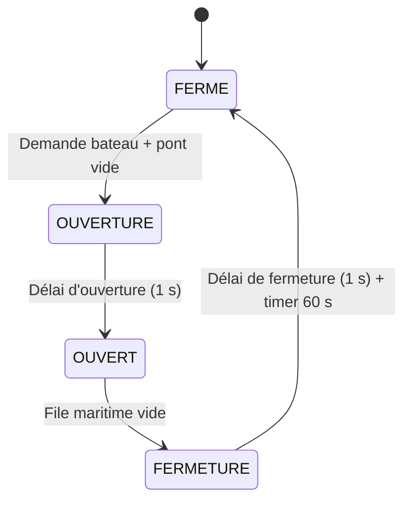

# Simulation d'un pont mobile bidirectionnel

Simulation multithread en Java d'un **pont mobile bidirectionnel** gérant simultanément la circulation routière (voitures, camions, convois exceptionnels, véhicules prioritaires) et le trafic maritime (bateaux nécessitant l'ouverture du pont), accompagnée d'une **visualisation animée en temps réel dans le terminal**.

> Projet réalisé dans le cadre de la ressource **R3.05 (Programmation système)** en BUT Informatique.

---

## Fonctionnalités clés

- **Circulation routière bidirectionnelle simultanée** : le pont est découpé en **2 voies indépendantes de 8 segments** (`GAUCHE_DROITE` et `DROITE_GAUCHE`), permettant aux véhicules de circuler dans les deux sens en parallèle sans blocage frontal.
- **4 catégories de véhicules routiers** :
  - **Voiture** (1 segment) et **Camion** (2 segments) avec réservation atomique des segments d'entrée pour éviter tout interblocage (*deadlock*).
  - **Convoi exceptionnel** (4 segments) : passage exclusif (un seul convoi à la fois via `Semaphore`), avec blocage et vidage préalable du sens opposé.
  - **Véhicule prioritaire** (Ambulance, Pompiers) : bloque immédiatement les nouvelles entrées, déclenche l'alerte d'urgence et attend que tous les véhicules déjà engagés se garent sur la **bande d'urgence** avant de traverser à vitesse rapide.
- **Trafic maritime avec file d'attente FIFO** : les bateaux (`NORD_SUD` et `SUD_NORD`) s'enregistrent dans une file `ConcurrentLinkedQueue`, déclenchent l'ouverture du pont dès que le tablier est vide, passent un par un, puis referment le pont.
- **Temporisation anti-famine** : après chaque fermeture complète du pont, un délai minimal de **60 secondes** est imposé avant toute nouvelle ouverture afin de laisser le trafic routier s'écouler.
- **Affichage console animé (ASCII + couleurs ANSI)** : suivi en direct de l'état du pont, des feux d'entrée, de la position de chaque véhicule, de la bande d'urgence et des bateaux sur la rivière.

---

## Technologies utilisées

- **Langage** : Java (bibliothèque standard uniquement, aucune dépendance externe)
- **Concurrence & synchronisation** : `Thread`, `ReentrantLock`, `Condition`, `Semaphore`, `ConcurrentLinkedQueue`, moniteurs `synchronized` (`wait` / `notifyAll`), `Timer` / `TimerTask`
- **Modélisation** : PlantUML ([`Diagramme.puml`](./Diagramme.puml))
- **Exécutable** : Archive JAR autonome ([`PontMobile.jar`](./PontMobile.jar))

---

## Prérequis

- **Pour exécuter directement `PontMobile.jar`** : **Java 25+** (le JAR fourni est compilé avec OpenJDK 25).
- **Pour compiler et exécuter depuis les sources** : **JDK 8 ou supérieur** (aucune librairie tierce requise).
- **Terminal compatible ANSI** : Windows Terminal, PowerShell moderne, terminal Linux/macOS ou console IntelliJ IDEA (nécessaire pour le rafraîchissement et les couleurs de l'animation console).

---

## Installation et lancement

### 1. Cloner le dépôt

```bash
git clone https://github.com/Clemzzz/Simulation-d-un-pont-mobile-bidirectionnel.git
cd Simulation-d-un-pont-mobile-bidirectionnel
```

### 2. Lancer la simulation

#### Option A — Via le JAR précompilé (Java 25+)

```bash
java -jar PontMobile.jar
```

#### Option B — Compiler et exécuter depuis les sources (tout JDK 8+)

**Linux / macOS :**

```bash
mkdir -p out
javac -encoding UTF-8 -d out src/Main.java src/Pont/*.java src/Vehicules/*.java src/Bateaux/*.java
java -cp out Main
```

**Windows (PowerShell) :**

```powershell
New-Item -ItemType Directory -Force -Path out | Out-Null
javac -encoding UTF-8 -d out (Get-ChildItem -Recurse -Filter *.java src | ForEach-Object { $_.FullName })
java -cp out Main
```

#### Option C — Régénérer le fichier `PontMobile.jar`

```bash
jar cfe PontMobile.jar Main -C out .
java -jar PontMobile.jar
```

---

## Architecture du projet

### Arborescence

```text
.
├── src/
│   ├── Main.java                                 # Point d'entrée et scénario de démonstration
│   ├── Pont/
│   │   ├── EtatPont.java                         # Enum des 4 états du pont mobile
│   │   ├── Pont.java                             # Synchronisation globale, barrière d'entrée, timer 60s
│   │   ├── Segment.java                          # Portion atomique d'une voie protégée par ReentrantLock
│   │   └── MoteurAffichageConsole.java           # Thread démon de rendu ASCII/ANSI (150 ms)
│   ├── Vehicules/
│   │   ├── Vehicule.java                         # Classe abstraite (Thread) et logique de traversée
│   │   ├── Voiture.java                          # Véhicule de taille 1 segment (400 ms/pas)
│   │   ├── Camion.java                           # Véhicule de taille 2 segments (600 ms/pas)
│   │   ├── ConvoiExceptionnel.java               # Véhicule de taille 4 segments (800 ms/pas, sens opposé bloqué)
│   │   ├── VehiculePrioritaire.java              # Ambulance / Pompiers (1 segment, 200 ms/pas, priorité absolue)
│   │   ├── ControleCirculation.java              # Régulation d'accès par tickets FIFO, blocages et urgences
│   │   └── BandeUrgence.java                     # Gestion du stationnement temporaire lors d'une urgence
│   └── Bateaux/
│       ├── Bateau.java                           # Thread bateau traversant sous le pont en 5 étapes
│       └── GestionnaireTraficMaritime.java       # File FIFO des bateaux et orchestration ouverture/fermeture
├── Diagramme.puml                                # Diagramme de classes PlantUML
├── parties_non_realisees.txt                     # Notes de conception et cas limites
└── PontMobile.jar                                # Archive JAR exécutable
```

### Cycle d'états du pont (`EtatPont`)



### Tableau des acteurs simulés

| Acteur | Classe | Taille | Vitesse / Durée | Comportement spécifique |
| :--- | :--- | :---: | :---: | :--- |
| **Voiture** | `Voiture` | 1 segment | `400 ms` / segment | Réserve les segments un par un ; se gare en cas d'urgence |
| **Camion** | `Camion` | 2 segments | `600 ms` / segment | Réserve 2 segments à l'entrée sans blocage (`tryLock`) ; se gare en cas d'urgence |
| **Convoi exceptionnel** | `ConvoiExceptionnel` | 4 segments | `800 ms` / segment | Un seul convoi à la fois (`Semaphore`) ; bloque et vide le sens opposé avant d'entrer |
| **Véhicule prioritaire** | `VehiculePrioritaire` | 1 segment | `200 ms` / segment | Bloque les entrées, déclare une urgence, attend l'arrêt des véhicules puis traverse |
| **Bateau** | `Bateau` | 5 étapes | `500 ms` / étape | Passe un par un en ordre FIFO lorsque le pont est `OUVERT` |

### Mécanismes de concurrence utilisés

| Classe | Mécanisme Java | Rôle |
| :--- | :--- | :--- |
| `Pont` | `ReentrantLock` + `Condition` (`autoriserEntree`, `pontVide`) | Barrière d'entrée routière et attente du vidage complet avant ouverture |
| `Pont` | `Timer` / `TimerTask` (démon) | Temporisation minimale de `60 000 ms` entre deux ouvertures pour les bateaux |
| `Segment` | `ReentrantLock` (`lock` / `tryLock`) | Exclusion mutuelle par segment ; `tryReserver()` évite les interblocages à l'entrée |
| `ControleCirculation` | Moniteur `synchronized` + système de tickets FIFO | Ordonnancement équitable par sens, gestion des tickets abandonnés, blocages convoi/urgence |
| `BandeUrgence` | Moniteur `synchronized` (`wait` / `notifyAll`) | Synchronisation de l'arrêt de tous les véhicules engagés et de leur redémarrage après l'urgence |
| `ConvoiExceptionnel` | `Semaphore(1, true)` | Garantit qu'un seul convoi exceptionnel traverse le pont à la fois (équitable) |
| `GestionnaireTraficMaritime` | `ConcurrentLinkedQueue` + `synchronized` + `Timer` | File d'attente FIFO des bateaux et coordination avec la temporisation du pont |

---

## Scénario de démonstration (`Main.java`)

Le point d'entrée [`src/Main.java`](./src/Main.java) exécute automatiquement une simulation complète mettant à l'épreuve l'ensemble des règles de synchronisation :

1. **Trafic mixte bidirectionnel** : lancement alterné de voitures et de camions dans les deux sens (`GAUCHE_DROITE` et `DROITE_GAUCHE`).
2. **Passage d'un convoi exceptionnel** (`GAUCHE_DROITE`) : blocage et vidage de la voie opposée, puis reprise normale.
3. **Intervention d'une ambulance** (`DROITE_GAUCHE`) : mise en stationnement sur la bande d'urgence de tous les véhicules présents, puis traversée rapide.
4. **Arrivée de deux bateaux** (`NORD_SUD` puis `SUD_NORD`) : fermeture des barrières routières, vidage du pont, ouverture du tablier, passage séquentiel FIFO des deux bateaux, puis fermeture et démarrage du minuteur de 60 secondes.
5. **Reprise du trafic et intervention des pompiers** (`GAUCHE_DROITE`) : circulation normale interrompue par le passage d'un véhicule prioritaire.
6. **Nouveau bateau (`SUD_NORD`) et second convoi (`DROITE_GAUCHE`)** : mise en attente du bateau jusqu'à expiration de la temporisation d'une minute pendant que le trafic terrestre continue.
7. **Fin de simulation** : attente de la terminaison de tous les threads (`join`), affichage final et arrêt propre du gestionnaire maritime.

---

## Légende de l'affichage console

L'interface ASCII rafraîchie toutes les `150 ms` par `MoteurAffichageConsole` utilise les symboles suivants :

| Symbole | Signification |
| :--- | :--- |
| `(V)` / `(R)` | Feu d'entrée vert (passage autorisé) / rouge (entrée bloquée) |
| `[V#>]` / `[<#V]` | Voiture circulant de gauche à droite / droite à gauche |
| `[=C#=>]` / `[<=C#=]` | Camion (2 segments) |
| `[==CONV#==>]` / `[<==CONV#==]` | Convoi exceptionnel (4 segments) |
| `[+AMB+>]` / `[+POMP+>]` | Véhicule prioritaire (Ambulance / Pompiers) |
| `[G:V#]` | Véhicule garé sur la bande d'urgence |
| `[B#v]` / `[B#^]` | Bateau en direction Nord → Sud / Sud → Nord |
| `=====` / `///\\\` / `\|   \|` | Tablier du pont `FERME` / en `OUVERTURE`-`FERMETURE` / `OUVERT` |

---

## Choix de conception et cas particuliers

Les arbitrages détaillés dans [`parties_non_realisees.txt`](./parties_non_realisees.txt) expliquent notamment :

- **Double voie vs voie unique** : le pont utilise deux tableaux de segments (un par sens) afin de permettre la circulation simultanée dans les deux directions, plutôt qu'une voie unique alternée par feux.
- **Arrivée d'un véhicule prioritaire en même temps qu'une entrée** : dès qu'un véhicule prioritaire est annoncé, les nouvelles entrées sont bloquées et le prioritaire attend que tous les véhicules déjà engagés (y compris un véhicule venant juste d'entrer) soient garés sur la bande d'urgence avant de s'élancer.

---

## Dépannage

### Erreur `UnsupportedClassVersionError` avec `PontMobile.jar`

`PontMobile.jar` a été compilé avec **Java 25** (version de classe 69). Si vous utilisez une version antérieure de Java (ex. JDK 17 ou 21), compilez simplement depuis les sources (voir **Option B** ci-dessus).

### Codes ANSI affichés en clair (`\033[...`) sur Windows

L'ancien Invite de commandes (`cmd.exe`) peut ne pas interpréter les séquences ANSI par défaut. Utilisez **Windows Terminal**, **PowerShell 7+** ou la console intégrée d'un IDE (IntelliJ IDEA, VS Code).

---

## Auteurs

- **Clément Bazin** ([@Clemzzz](https://github.com/Clemzzz))
- **Tom Malherbe** ([@TomM4lh3rbe](https://github.com/TomM4lh3rbe))
